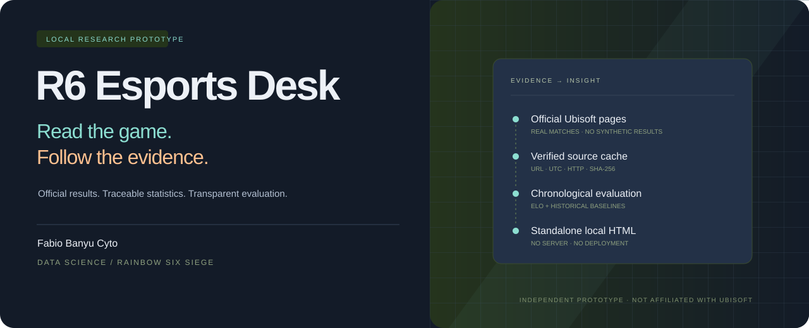

<p align="center"></p>

<p align="center">
  
  
  
  <a href="https://github.com/fabiobanyu/r6-analytics-prototype/actions/workflows/validate.yml"></a>
</p>

# R6 Esports Desk

**Read the game. Follow the evidence.**

Prototype analisis Rainbow Six Siege esports oleh **Fabio Banyu Cyto**. Jelajahi hasil pertandingan asli, lihat pola kemenangan peta, telusuri statistik pemain, dan periksa baseline prediksi Elo beserta evaluasinya. Seluruh antarmuka berjalan sebagai HTML lokal.

**Tidak ada data pertandingan sintetis.** Hasil, ronde, pemain, dan operator ban berasal dari halaman publik resmi [Ubisoft R6 Esports](https://www.ubisoft.com/en-us/esports/rainbow-six/siege/competition/502). Pilihan operator dan ronde menang memakai snapshot tambahan [r6tv Salt Lake City Major](https://r6tv.online/event/salt-lake-city-major), dengan cakupan terpisah. Estimasi model ditandai terpisah dari hasil pertandingan dan tidak menulis hasil baru ke dataset.

Desain memakai nuansa tactical esports dengan latar biru baja, kontras lembut, aksen amber/teal, font Manrope dan Barlow Condensed yang disimpan lokal, serta ikon operator resmi. Komposisi antarmukanya dibuat sendiri.

**Untuk pembaca baru:** mulai dari pertanyaan di Ringkasan, buka panduan empat langkah, atau klik **?** untuk memahami istilah. Nama operator, peta, minggu, tim, dan nomor ronde dapat dijelajahi dengan klik. Baca [panduan penggunaan singkat](docs/QUICKSTART.md).

## Coba dalam satu langkah

Unduh repository melalui **Code → Download ZIP**, ekstrak, lalu buka **`index.html`** atau **`Buka Demo.cmd`**. Tidak perlu instalasi, server, database, akun, atau koneksi internet untuk membaca snapshot yang disertakan.

HTML berisi snapshot tertanam sehingga bisa dibuka sendiri. Simpan folder `data/` di sampingnya untuk membaca pembaruan lokal dan mengunduh dataset melalui tautan antarmuka. Repository ini **tidak dideploy** dan tidak mengaktifkan GitHub Pages.

## Yang bisa dieksplorasi

| Fitur | Yang dihitung |
|---|---|
| Ringkasan & tren | Series selesai per minggu, peta selesai, detail terunduh, ronde tercatat |
| Map intelligence | Kemenangan sisi serang dari ID penyerang dan pemenang ronde asli |
| Operator intel | Favorit berdasarkan pemilihan, ronde menang terbanyak, win rate, minimum sampel, filter sisi/tim, serta ekspor CSV |
| Ban pressure | Operator diban per peta unik, terpisah dari statistik pemilihan |
| Match explorer | Filter kompetisi/tim, pencarian, pagination, skor, detail ronde & pemain |
| Team form | Elo per series, tanpa penghitungan ulang akibat baris pemain |
| Player records | Kill, K/D, KOST tertimbang ronde dalam cakupan filter |
| Baseline model | Perbandingan dua tim, Brier, log loss, akurasi favorit, baseline proporsi historis |
| Transparansi | URL, tanggal unduh UTC, status HTTP, SHA-256, coverage dan status pembaruan |
| Ekspor | JSON lengkap dan CSV hasil filter; CSV tabel tersedia dalam `data/` |
| Panduan awam | Ringkasan dalam kalimat, panduan empat langkah, kamus istilah, dan penjelasan angka saat diklik |
| Jelajah interaktif | Klik minggu/peta untuk menyaring pertandingan, buka perbandingan operator, tukar tim, dan periksa hasil setiap ronde |

## Snapshot yang disertakan

Snapshot awal terunduh **31 Oktober 2026, UTC**, dengan laga selesai terbaru **24 Oktober 2026**. Tanggal unduh berbeda dari tanggal pertandingan.

| Ukuran | Jumlah |
|---|---:|
| Series | 414 |
| Series selesai / terjadwal dengan tim diketahui | 410 / 4 |
| Halaman detail series terunduh | 410 |
| Peta selesai | 620 |
| Ronde tercatat | 6.696 |
| Baris pemain × peta | 6.200 |
| Baris operator ban | 7.054 |
| Halaman sumber terverifikasi | 450 |

Cakupan mencakup event global musim 2026–2027 serta stage regional yang ditampilkan sebagai default saat pengambilan sumber: EML, NAL, SAL, CNL dan tiga subregion APL. **Ini bukan arsip lengkap seluruh musim.** Sebanyak 46 slot/record dengan tim atau metadata yang belum lengkap dicatat dalam metadata, tanpa membuat pengganti. Nama organisasi mengikuti nama yang saat ini ditampilkan sumber, termasuk pada laga historis.

Angka di atas merupakan ringkasan snapshot awal, bukan angka yang dijanjikan selalu tetap. Lihat `data/snapshot.json`, antarmuka, dan [manifest data](docs/DATA.md) untuk versi terbaru.

Snapshot operator tambahan mencakup 73 operator/sisi, 886 pengamatan ronde serang dan 887 bertahan pada SLC Major. Deimos paling sering dipilih untuk menyerang (308), Smoke untuk bertahan (382) sekaligus mencatat ronde menang terbanyak (198). Dengan minimum 30 pemilihan, win rate tertinggi adalah Pulse, 35/52 = 67,3%. Ini statistik ronde dalam cakupan replay sumber, bukan kemenangan series atau bukti operator menyebabkan kemenangan. Lihat [metode dan provenance operator](docs/OPERATORS.md).

## Pembaruan otomatis

Python **3.11+**, standard library saja, diperlukan untuk memperbarui data.

```powershell
# Sekali, gunakan cache halaman yang masih segar
python scripts/update_data.py

# Polling setiap 6 jam selama proses berjalan
python scripts/update_data.py --watch

# Segera periksa ulang indeks resmi
python scripts/update_data.py --force
```

Di Windows, klik **`Jalankan Pembaruan Otomatis.cmd`** atau **`Perbarui Data Sekarang.cmd`**. Launcher memakai `py -3`; gunakan perintah `python` jika Python Launcher tidak terpasang.

Pembaru menemukan musim aktif dari navigasi resmi, memeriksa kompetisi dan fase, lalu menambahkan maksimal 80 halaman detail baru per siklus. Halaman indeks menggunakan cache 6 jam; detail series selesai diperiksa ulang setelah 7 hari. Maksimal 3 koneksi bersamaan, timeout 35 detik, dan maksimal 3 percobaan. Ini polling, bukan feed langsung.

HTML yang terbuka memeriksa `data/latest.js` dan `data/status.js` setiap 60 detik melalui script lokal, sehingga tidak membutuhkan `fetch()` terhadap `file://`. Tombol **Baca data terbaru** hanya membaca file lokal; pengunduhan Ubisoft dilakukan Python.

Komputer, internet, dan proses pembaru perlu aktif. Jika menggunakan penjadwal lain, jalankan pembaruan sekali per 6 jam; jangan jalankan bersamaan dengan `--watch`. Kunci satu penulis mencegah dua pembaru menimpa snapshot. Perubahan sumber atau kegagalan validasi mempertahankan snapshot terakhir dan menulis status gagal. Pembaruan lokal tidak melakukan commit atau push GitHub.

**Pembaruan otomatis ini berlaku untuk hasil dan ban Ubisoft. Snapshot pemilihan operator r6tv diperbarui terpisah melalui impor sumber terverifikasi; tidak di-scrape berkala dan tidak diklaim mencakup semua event.** Cakupan serta tanggalnya selalu ditampilkan pada panel.

## Hasil model: eksplorasi, belum bukti prediksi kuat

Elo awal 1500, K=24, skala 400; parameter tidak dituning. Dua series forfeit dikeluarkan dari pelatihan/evaluasi. Prediksi tiap timestamp dibuat sebelum hasil pada timestamp itu dipakai. Evaluasi membutuhkan minimal 3 series sebelumnya per tim; perbandingan tim baru membutuhkan minimal 5.

| Evaluasi historis pada 274 series | Elo | Tebakan 50% | Proporsi tim A dari hasil sebelumnya |
|---|---:|---:|---:|
| Brier ↓ | 0,2423 | 0,2500 | 0,2427 |
| Log loss ↓ | 0,6777 | 0,6931 | 0,6786 |
| Akurasi favorit | 60,6% | — | Selalu tim A: 59,5% |

Keunggulan terhadap baseline proporsi historis sangat kecil. Urutan tim pada sumber dapat mengandung bias. Cakupan terbatas, perubahan roster, patch, peta, dan kekuatan antarregion belum dimodelkan. **Angka ini bukan klaim akurasi pada pertandingan berikutnya.** Lihat [metode](docs/METHODOLOGY.md), [laporan HTML](outputs/report.html), dan [hasil terstruktur](outputs/analysis.json).

## Reproduksi & pengujian

Node **24.15+** (atau versi yang sesuai `engines` dalam `package.json`) diperlukan hanya untuk pengujian DOM dan regenerasi laporan analisis; demo dan pembaru Python tidak membutuhkannya.

```powershell
python scripts/validate_data.py
python scripts/validate_operators.py
python scripts/build.py
python scripts/export_data.py
npm ci --ignore-scripts
npm test
node scripts/analyze.cjs
```

21 pengujian otomatis lulus setelah pembaruan interaksi: keunikan ID/grain, provenance, kebocoran label, batch timestamp sama, baseline, nilai kosong/0, filter, navigasi, detail, estimasi, CSV, refresh cache, cache rusak, jaringan gagal, perbedaan pemilihan/menang/win rate, pemisahan cohort, minimum sampel, peta ban unik, konsistensi filter peta/minggu, serta alur pengguna baru. Validator mencocokkan statistik dengan ekstrak sumbernya masing-masing.

Uji UI memakai **jsdom**, bukan browser visual. Browser pengujian menolak `file://`; tampilan responsif, dialog native, dan unduhan browser masih memerlukan verifikasi manual. [Checklist QA](docs/QA.md) mencatat batas pengujian ini. GitHub Actions hanya melakukan validasi dan tes, tanpa deployment.

## Peta repository

```text
index.html                 Demo mandiri dengan snapshot tertanam
src/                       Template, CSS, UI, dan mesin analisis
scripts/update_data.py     Unduh sumber asli, cache, validasi, publish snapshot
scripts/validate_data.py   Cocokkan tabel ternormalisasi dengan sumber terunduh
scripts/build.py           Bangun ulang HTML tanpa dependensi Python eksternal
scripts/export_data.py     Ekspor tabel ke CSV
scripts/analyze.cjs        Evaluasi, grafik SVG, dan laporan HTML
data/snapshot.json         Dataset terstruktur + metadata + manifest
data/operators.json        Snapshot operator tambahan + metadata sumber/cakupan
data/operator_sources/     Ekstrak board operator yang dapat diperiksa ulang
data/raw/*.json.gz         Ekstrak sumber resmi, diberi nama SHA-256
data/*.csv                 Tabel series, peta, ronde, pemain, operator ban
outputs/                   Laporan, hasil validasi, analisis, grafik
tests/                     Tes logika, DOM, dan ketahanan pembaru
docs/                      Kamus data, metode, dan QA
```

Prototype independen oleh [Fabio Banyu Cyto](https://github.com/fabiobanyu). Rainbow Six Siege dan data sumber terkait merupakan milik/publikasi Ubisoft dan pihak terkait; proyek ini tidak berafiliasi dengan Ubisoft. Tidak ada data match publik/ranked atau akses API privat. File `.env`, database, virtual environment, installer, dan backup proyek lama tidak disertakan.
